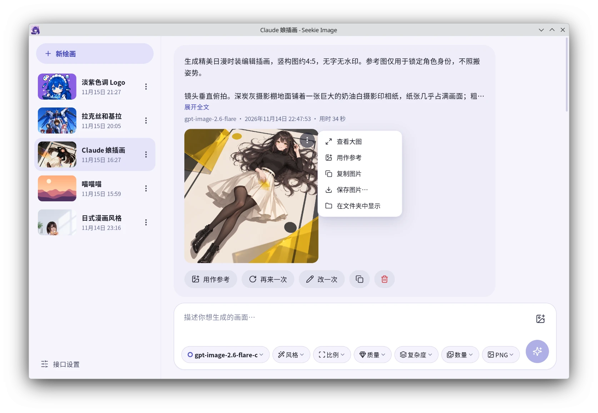

# Seekie-Image

[](https://github.com/shellexy/seekie-image/releases) [](https://github.com/shellexy/seekie-image/actions/workflows/build.yml) [](LICENSE) 

接 OpenAI 兼容绘图接口（官方接口，或 new-api / one-api 一类中转站）的桌面小工具。
Python 后端 + pywebview 窗口，界面是原生 HTML/CSS/JS，没有构建步骤。

## 截图



<nav role="doc-toc" aria-label="目录">
<div role="heading" aria-level="2">目录</div>
<ul>
  <li><a href="#user-content-seekie-image">Seekie-Image</a>
    <ul>
      <li><a href="#user-content-截图">截图</a></li>
      <li><a href="#user-content-下载安装包">下载安装包</a></li>
      <li><a href="#user-content-安装">安装</a>
        <ul>
          <li><a href="#user-content-linux-上的启动器和图标">Linux 上的启动器和图标</a></li>
          <li><a href="#user-content-不安装直接运行">不安装直接运行</a></li>
          <li><a href="#user-content-常用参数">常用参数</a></li>
          <li><a href="#user-content-只开一个窗口">只开一个窗口</a></li>
        </ul>
      </li>
      <li><a href="#user-content-窗口标题">窗口标题</a></li>
      <li><a href="#user-content-粘贴和右键菜单">粘贴和右键菜单</a></li>
      <li><a href="#user-content-一次多张和中间预览">一次多张和中间预览</a></li>
      <li><a href="#user-content-开发者工具">开发者工具</a></li>
      <li><a href="#user-content-配置接口">配置接口</a></li>
      <li><a href="#user-content-不花钱先试一下">不花钱先试一下</a></li>
      <li><a href="#user-content-数据放在哪">数据放在哪</a></li>
      <li><a href="#user-content-代码结构">代码结构</a></li>
      <li><a href="#user-content-打包">打包</a></li>
      <li><a href="#user-content-目前没有做的">目前没有做的</a></li>
      <li><a href="#user-content-许可证">许可证</a></li>
    </ul>
  </li>
</ul>
</nav>

## 下载安装包

从 [Releases](https://github.com/shellexy/seekie-image/releases) 下载：

| 系统 | 文件 | 说明 |
|---|---|---|
| Linux | `seekie-image_<版本>_all.deb` | 纯 Python 包；由 apt 装上 python3-webview / httpx / Pillow 和 GTK / WebKit 依赖 |
| Linux | `Seekie-Image-<版本>-x86_64.AppImage` | 自带 Python 依赖；GTK / WebKit 用系统的 |
| Windows | `Seekie-Image-<版本>-Setup.exe` | Windows 10/11；需要 WebView2 运行时（一般已自带） |

macOS 暂时没有预编译包，用下面的 `pip install .` 安装。

> `.deb` 不再冻结 Python 或 GTK/WebKit，只把 Python 代码装进 `/usr/lib/python3/dist-packages/seekie_image`；
> 运行时用系统的 `python3` 和 `python3-webview`（Ubuntu 24.04 提供 5.0.5），需要能提供
> `python3-webview >= 5.0`、`python3-httpx >= 0.26`、`python3-pil >= 10.0` 的发行版。
> 流式响应由程序自己解析，不需要 `python3-httpx-sse`。
> AppImage 仍由 Ubuntu 24.04 构建，自带 Python，GTK/WebKitGTK 取系统的，需要 glibc 2.39+。
>
> Windows 安装包没有代码签名，首次运行可能被 SmartScreen 拦一下，选「更多信息 → 仍要运行」即可。
>
> 如果之前用 `pip install .` 装过，建议先 `pip uninstall seekie-image` 并确认 `which -a seekie-image`；
> 否则 `~/.local/bin` 里的旧启动器可能优先于 deb 安装的 `/usr/bin/seekie-image`。

## 安装

需要 Python 3.10 或更新版本。在项目目录里执行：

```bash
pip install .          # Linux 上想连 Qt 界面后端一起装：pip install ".[qt]"
seekie-image
```

请用 `pip install .`，不要用 `python setup.py install`：后者已被 setuptools 废弃，
而且不会把启动器和图标放到正确的位置。

各系统的界面后端：

* **Windows**：用系统自带的 WebView2（Win10/11 一般已有）。安装后另有一个不带黑色控制台窗口的入口 `seekie-imagew`。
* **macOS**：直接可用。
* **Linux**：pywebview 需要一个图形后端，二选一：
  * Qt：`pip install ".[qt]"`（PyQt6）或 `pip install ".[pyside6]"`；
  * GTK：用系统包，Debian/Ubuntu 是 `sudo apt install python3-gi gir1.2-gtk-3.0 gir1.2-webkit2-4.1`。
    系统包只对系统 Python 可见，放在虚拟环境里要用 `python3 -m venv --system-site-packages` 建环境。

### Linux 上的启动器和图标

`setup.py` 会把 `seekie-image.desktop` 装到 `<前缀>/share/applications/`，
把 16–256 像素的图标装到 `<前缀>/share/icons/hicolor/<尺寸>/apps/seekie-image.png`。
「前缀」取决于安装方式：

| 安装方式                   | 前缀                     | 应用菜单里能否直接看到 |
| ---------------------- | ---------------------- | ----------- |
| `pip install --user .` | `~/.local`             | 能           |
| `sudo pip install .`   | `/usr/local`（或 `/usr`） | 能           |
| 虚拟环境、pipx              | 环境自己的目录                | 不能，需要下面这一步  |

装在虚拟环境或 pipx 里，或者菜单里点了图标没反应（多半是 `~/.local/bin` 不在桌面会话的 `PATH` 里）时，再执行一次：

```bash
seekie-image --install-desktop
```

它把同一份启动器和图标复制到 `~/.local/share/`，并把启动命令写成这份安装的绝对路径。
新图标可能要等桌面刷新缓存或重新登录后才出现。

卸载：

```bash
seekie-image --uninstall-desktop   # 只有执行过 --install-desktop 才需要
pip uninstall seekie-image
```

### 不安装直接运行

```bash
pip install -r requirements.txt
python main.py
```

### 常用参数

| 参数                                          | 作用                                                |
| ------------------------------------------- | ------------------------------------------------- |
| `--browser`                                 | 不开桌面窗口，改用系统浏览器打开界面                                |
| `--data-dir 路径`                             | 指定配置和历史记录所在的目录（也可以用环境变量 `SEEKIE_IMAGE_HOME`）      |
| `--images-dir 路径`                           | 指定生成的图片保存到哪，默认是数据目录里的 `images/`                   |
| `--port 端口`                                 | 固定本机端口，默认随机                                       |
| `--debug`                                   | 输出调试日志，并且一启动就打开开发者工具（平时按 Ctrl+Shift+I 就行，不需要这个参数） |
| `--install-desktop` / `--uninstall-desktop` | Linux：安装 / 移除当前用户的启动器和图标                          |

### 只开一个窗口

同一份数据目录（`--data-dir`，默认位置见「数据放在哪」）同时只运行一个实例：

* 已经开着一个时，再点图标或再执行 `seekie-image` 不会开第二个窗口。它请原来那个进程把窗口
  调到前面，然后自己退出；原来那个跑在 `--browser` 模式时，改成在浏览器里打开它的地址。
* 第二次启动如果自己带了 `--browser`，就不去打扰桌面窗口，直接在浏览器里打开已有实例的地址；
  带 `--no-open` 时只打印地址。
* 第二次启动的 `--port`、`--debug` 等参数不会改变已经运行的那个实例。换一份数据目录才会
  另开一个实例，两者互不影响。
* 程序在数据目录里用 `instance.lock` 占位、用 `instance.json` 记下自己的界面地址和令牌。
  锁由操作系统管理，进程崩溃或被 kill 时自动释放，不需要手工清理。

## 窗口标题

打开一组绘画时，页面标题和桌面窗口标题会显示「绘画名 - Seekie Image」；新建绘画时只显示
`Seekie Image`。绘画名就是左侧列表里的标题，可以在那里右键重命名。

## 粘贴和右键菜单

* **粘贴图片**：在输入框里按 Ctrl+V（macOS 是 ⌘V），剪贴板里的图片会变成参考图；文字照常粘贴。
  截图、从别的程序里复制的图片、在文件管理器里复制的图片文件都可以。也可以把图片文件拖进窗口。
* **输入框右键**：剪切 / 复制 / 粘贴 / 全选 / 添加参考图。接口设置里的各个输入框也有同样的编辑菜单。
* **图片右键**：查看大图 / 用作参考 / 复制图片 / 保存图片 / 在文件夹中显示，和图片右上角 ⋮ 按钮里的一样。
  放大查看时也可以右键。
* **记录里的参考图**：点一下放大查看，右键是和图片一样的菜单。
* **左侧列表右键**：重命名 / 删除。

桌面窗口里的剪贴板读写由 Python 后台完成（`seekie_image/clipboard.py`），因为 pywebview 关掉了内核自带的右键菜单，
而页面脚本在 WebKitGTK 和 Qt WebEngine 里都读不到剪贴板。
用 `--browser` 在浏览器里打开时，输入框保留浏览器自己的右键菜单，图片和列表仍然用上面这套。

## 一次多张和中间预览

* **一次多张**：输入框下面「复杂度」右边的「数量」，可以选 1–4 张，默认 1 张，选过的数量下次还在。
  `Images API` 模式下发的是请求体里的 `n`；`Chat Completions` 模式没有这个参数，会同时发出几次请求。
  多张图各存各的文件和 `.txt`。接口返回的张数比要的少时（有些中转站不认 `n`），记录下面会写明要了几张、回了几张。
* **中间预览**：在「接口设置」里勾上「流式生成，边画边显示预览图」后，请求会带上
  `"stream": true, "partial_images": 2`，生成过程中占位格里的画面会由模糊变清楚，最后换成成品。
  * 只对 `Images API` 模式有效，默认不勾。
  * 中转站不认识这两个参数、直接拒绝请求时，会自动去掉它们重发一次，照常出图，只是没有预览。
  * 想要 3 张中间图，在额外参数里写 `{"partial_images": 3}`（0–3）。
  * 按官方计费，每张中间图多算 100 个图片输出 token。
  * 预览图只在内存里，不落盘；生成完、取消或失败后就丢掉。
  * 一次多张再加流式时，官方文档没有说明中间图怎么区分属于哪一张。接口事件里带 `output_index` 时各格显示各自的预览，
    不带时预览都显示在第一格。这一点只用项目自带的假接口验证过。

## 开发者工具

桌面窗口里按 **Ctrl+Shift+I**（或 F12，macOS 是 ⌘⌥I）打开内核自带的开发者工具，再按一次关闭。

* GTK（WebKitGTK）后端：检查器贴在窗口下半部分，可以在检查器里把它拆成独立窗口。
* Qt（Qt WebEngine）后端：检查器开在一个单独的窗口里。
* 焦点在检查器里时，快捷键归检查器自己管；要关的话点它的关闭按钮，或者先点一下主窗口再按。
* `--browser` 模式下这个快捷键不拦截，用的是浏览器自己的开发者工具。
* Windows 和 macOS 上没有接这个快捷键，那里还是要用 `--debug` 启动。

## 配置接口

左下角「接口设置」里添加服务商：

* **接口地址**：只填域名会自动补 `/v1`；已经带版本号的路径（如 `/api/v3`）原样使用；
  以 `#` 结尾表示完全不要补全。输入框下面会显示补全后的实际请求地址。
* **接口类型**：
  * `Images API`：走 `/images/generations`，带参考图时走 `/images/edits`。gpt-image 系列用这个。
  * `Chat Completions`：给那些把绘图模型挂在对话接口上的中转站用。只发送提示词和参考图。
* **模型**：每行一个，可以点「从接口获取」从 `/models` 里挑。
* **额外参数（JSON）**：合并进每次请求体，并覆盖界面上的同名选项。比如
  `{"output_format": "webp"}`、`{"background": "transparent"}`。
* **流式生成**：见上面「一次多张和中间预览」。中转站经常在 100 秒左右网关超时，如果它支持流式，
  勾上以后连接会一直有数据，不容易被网关掐断。

界面上的选项和请求参数的对应关系：

| 选项  | 请求字段         | 说明                                                    |
| --- | ------------ | ----------------------------------------------------- |
| 比例  | `size`       | 选「自动」时不发送；可以自定义 `宽x高`                                 |
| 质量  | `quality`    | `low` / `medium` / `high` / `xhigh` / `max`，选「自动」时不发送 |
| 复杂度 | `complexity` | gpt-image-2.6 的新参数，选「默认」时不发送                          |
| 数量  | `n`          | 默认 1                                                  |
| 风格  | 无            | 在提示词末尾追加一句风格描述                                        |

`xhigh`、`max` 和 `complexity` 是 gpt-image-2.6 才有的，发给旧模型会被接口拒绝。

代理环境变量（`http_proxy` / `https_proxy` / `no_proxy`）照常生效。如果 `NO_PROXY` 里写了
`[::1]` 这种带方括号的 IPv6，程序会自动改写成 `::1` 再交给 httpx，不需要手动清理。

## 不花钱先试一下

仓库里带了一个假的接口，画的是随机配色的山和太阳：

```bash
python mock_api.py --port 8787 --delay 3
```

然后在设置里添加服务商，接口地址填 `http://127.0.0.1:8787`，API Key 随便填。
提示词里写 `[error]` 或 `[timeout]` 可以看到出错时的样子。
它认 `n`，也支持流式：勾上「流式生成」就能看到由模糊变清楚的中间预览图。API Key 填 `nostream` 时它会拒绝流式参数，可以看到自动重发的效果。

## 数据放在哪

| 系统      | 配置和历史记录                                               | 生成的图片                                                |
| ------- | ----------------------------------------------------- | ---------------------------------------------------- |
| Linux   | `~/.config/seekie-image`（设置了 `XDG_CONFIG_HOME` 时在它下面） | `~/.config/seekie-image/images/`                     |
| Windows | `%APPDATA%\seekie-image`                              | `%APPDATA%\seekie-image\images\`                     |
| macOS   | `~/Library/Application Support/seekie-image`          | `~/Library/Application Support/seekie-image/images/` |

配置目录里有：

* `config.json`：接口配置，**API Key 是明文**；
* `history.db`：历史记录；
* `thumbs/`：缩略图；
* `refs/`：你上传或粘贴进来的参考图；
* `instance.lock` / `instance.json`：单实例用的锁，以及界面地址和本机接口令牌（程序运行期间才有意义）。

图片目录里只有生成的原图和同名的说明文件，文件名是生成时间加几位随机字符：

```
20261114-150406-9b079a.png
20261114-150406-9b079a.txt
```

`.txt` 里记着这张图的提示词、模型、服务商、风格、比例、质量、复杂度、数量（一次多张时）、额外参数、参考图数量、图片尺寸和生成时间。
它只是给人看的记录，应用自己不读它；API Key 不会写进去。

几点说明：

* 图片总是放在数据目录的 `images/` 里，用 `--data-dir` 或 `SEEKIE_IMAGE_HOME` 换了数据目录时也跟着走；
  想放到别处（比如「图片」目录）就加 `--images-dir`。
* 在应用里删除一条记录或一整组绘画时，对应的图片、`.txt`、缩略图会一并删除。
* 反过来，在文件管理器里把图片移走或删掉，应用里的记录还在，显示的是缩略图，「保存」「复制」等操作会提示文件不存在。

## 代码结构

```
setup.py             安装脚本（Linux 上同时安装 .desktop 和图标）
main.py              不安装时的启动入口
mock_api.py          假接口
seekie_image/
  app.py             解析参数，起本机服务和 pywebview 窗口
  server.py          本机 HTTP 服务：页面、图片、JSON 接口
  core.py            应用逻辑：配置、历史、图片文件、后台生成任务
  provider.py        请求绘图接口，兼容各种响应形状
  store.py           SQLite
  config.py          数据目录、配置文件、下拉菜单的选项
  instance.py        单实例：数据目录锁，第二次启动时唤醒已有窗口
  clipboard.py       读写系统剪贴板（GTK / Qt / Windows / macOS 各一套）
  devtools.py        Ctrl+Shift+I 打开 / 关闭内核的开发者工具（GTK / Qt）
  desktop.py         --install-desktop / --uninstall-desktop
  assets/            图标（icon.png、seekie-image.ico、hicolor/ 各尺寸）和 .desktop 文件
  web/               界面（index.html / app.css / app.js / logo.png）
tests/               后端测试：python -m unittest discover -s tests
packaging/           PyInstaller 配置、Linux 的 deb / AppImage、Windows 的 Inno Setup
.github/workflows/   推 v* 标签时构建并发布安装包
```

界面和后端之间走的是本机 HTTP（只监听 127.0.0.1，接口要带页面里注入的令牌，并校验 Host 头），
没有用 pywebview 的 js_api。好处是图片可以直接用 `` 加载，`--browser` 模式也能用同一套代码调试。
pywebview 只负责开窗口和「另存为」对话框。

窗口图标只在 Linux（GTK / Qt 后端）上由程序设置；Windows 和 macOS 的窗口图标取决于可执行文件，
直接用 Python 运行时显示的是 Python 的图标，打包后才是应用自己的。

## 打包

推一个 `v*` 标签时，[.github/workflows/build.yml](.github/workflows/build.yml) 会构建并发布：

* Linux：`.deb` 和 AppImage；
* Windows：Inno Setup 安装包。

在 Actions 里手动触发 `Build` 只构建、不发布，方便先验证。本地构建：

```bash
# Linux deb：纯 Python，不需要 PyInstaller
bash packaging/linux/build-deb.sh

# AppImage：需要 PyInstaller
pip install . pyinstaller
pyinstaller --noconfirm --clean packaging/pyinstaller/seekie-image.spec
bash packaging/linux/build-appimage.sh

# Windows：需要 Inno Setup 6
ISCC.exe /DMyAppVersion=0.4.1 packaging\windows\seekie-image.iss
```

产物都在 `dist/` 里。`.deb` 是 `Architecture: all` 的纯 Python 包，使用系统的
`python3-webview` 和 GTK / WebKitGTK；AppImage 自带 Python 和 Python 依赖，GTK / WebKit
仍取系统的。`.github/workflows/build.yml` 里用 Ubuntu 24.04 的系统包跑测试，
并包含浏览器模式和 Xvfb 原生窗口的冒烟测试。

### 图标

`seekie_image/assets/icon.png` 是图标母版（正方形、带透明通道）。改完执行：

```bash
python packaging/make-icons.py
```

它会重新生成 Linux 桌面用的 `assets/hicolor/<尺寸>/apps/seekie-image.png`、AppImage 的根图标，
以及 Windows 程序 / 安装包 / 快捷方式用的 `assets/seekie-image.ico`。GTK 窗口图标直接读
`icon.png`，不用另外生成；网页里的 `web/logo.png` 是单独的一张插图，不会被这个脚本改动。

## 目前没有做的

* 「做成视频」：那是另一套视频接口。
* Windows / macOS 上的 Ctrl+Shift+I（那里要用 `--debug`）。
* 一次超过 4 张：界面上最多选 4 张，更多可以在额外参数里写 `{"n": 8}`。

## 许可证

MIT，见 [LICENSE](LICENSE)。
